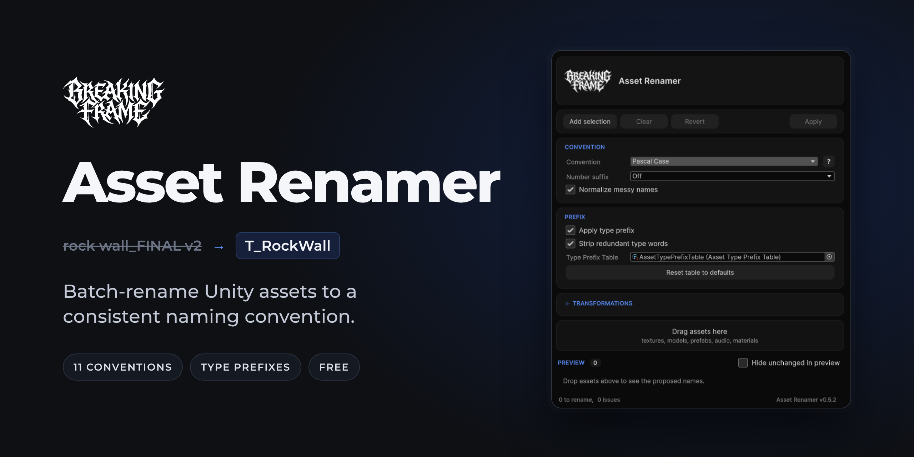

# Asset Renamer

Batch-rename Unity assets to a consistent naming convention from a single editor window.

Because your files were named by a raccoon.

## Features

- 11 naming conventions, from PascalCase to COBOL-CASE.
- Automatic type prefixes (`T_`, `SM_`, `PF_`, `M_`...) from an editable prefix table.
- Cleans messy names: accents, copy markers like `(1)` or `copy`, type words that repeat the prefix.
- Number suffix padding, including an Auto mode that aligns a whole batch.
- Find / replace and custom prefix / suffix.
- Live preview with a status on every row before anything is renamed.
- Renames through `AssetDatabase` (GUIDs and references are kept), with a one-click Revert of the last batch.

## Requirements

- Unity 6 (6000.0) or later.
- Editor-only: the code lives in an Editor assembly and adds nothing to builds.

## Install

Window > Package Manager > + > Install package from git URL:

```
https://github.com/ZellTBH/AssetRenamer.git
```

To pin a version, append its tag. In `Packages/manifest.json`:

```json
"com.tools.assetrenamer": "https://github.com/ZellTBH/AssetRenamer.git#0.5.2"
```

Note on the **Update available** button: it reinstalls the package from the plain git URL, without a tag. It installs whatever is at the head of `main` and removes the `#version` pin from your manifest. If you pin versions, update by editing the tag in the manifest instead.

## Usage

Open the window with **Breaking Frame > Asset Renamer**.

**Toolbar**

- **Add selection**: adds the assets selected in the Project window.
- **Clear**: empties the list.
- **Revert**: renames the last applied batch back to its original names. Shows the number of assets it will revert.
- **Apply**: renames every row with the Ok status.

Clear, Revert and Apply are disabled when there is nothing to do.

**Adding assets**

Drag assets from the Project window onto the drop zone, or use **Add selection**. Folders are expanded to all the assets they contain, subfolders included. Only paths under `Assets/` are accepted; assets from `Packages/` are ignored.

**Sections**

- **Convention**: the naming convention, the number suffix and name normalization. The **?** button opens a panel that shows every convention applied to a sample name, with the active one highlighted.
- **Prefix**: the type prefix, redundant word stripping and the prefix table.
- **Transformations**: find / replace and custom affixes. Collapsed by default; its title gets a `*` when a transformation is active.
- **Preview**: one row per asset, `old name -> new name`, with a status. **Hide unchanged in preview** hides the rows that already conform. The footer shows how many assets will be renamed and how many have issues.

The preview updates as soon as an option changes. Nothing is renamed until you click **Apply**.

## Options

### Number suffix

`Off`, `1`, `01`, `001`, `Auto`.

- **Off**: numbers stay where they are, untouched.
- **1 / 01 / 001**: the number is padded with zeros to at least that width (`tree1` -> `Tree01` with `01`). A longer number is never cut (`tree123` stays `Tree123` with `01`).
- **Auto**: every number is padded to the widest one in the batch, so `1..15` becomes `01..15` and sorts correctly.

When padding is on, the number is moved to the end of the name and joined with the convention's separator (`tree_01` in snake_case). It takes the last group of digits in the name, even in the middle: `rock2_big` becomes `RockBig02` with `01`.

### Normalize messy names

On by default. Before formatting, removes accents (an accented `e` becomes a plain `e`), numbered copy markers like `(1)`, and the words `copy`, `copie`, `copia` and `kopie`.

### Apply type prefix

On by default. Prepends the prefix that the prefix table gives for the asset. A name that already starts with that prefix is not prefixed twice (`t_brick.png` -> `T_Brick`). The prefix is written as it is in the table and is never re-cased by the convention.

Extension rules are checked first, then type rules (a type rule also matches subclasses of that type). Default table:

| Match | Pattern | Prefix |
|---|---|---|
| Extension | `.fbx`, `.obj`, `.blend` | `SM_` |
| Extension | `.prefab` | `PF_` |
| Extension | `.png`, `.tga`, `.psd`, `.jpg`, `.jpeg`, `.exr`, `.tif` | `T_` |
| Extension | `.wav`, `.mp3`, `.ogg` | `SFX_` |
| Extension | `.anim` | `A_` |
| Extension | `.controller` | `AC_` |
| Extension | `.mat` | `M_` |
| Extension | `.shader`, `.shadergraph` | `SH_` |
| Extension | `.vfx` | `VFX_` |
| Type | `Texture` | `T_` |
| Type | `Material` | `M_` |
| Type | `Mesh` | `SM_` |
| Type | `AnimationClip` | `A_` |
| Type | `AudioClip` | `SFX_` |
| Type | `Shader` | `SH_` |
| Type | `GameObject` | `PF_` |

An asset that matches no rule gets no prefix.

### Strip redundant type words

On by default, and only active with **Apply type prefix**. Drops words that only repeat the type: `wall_mat` -> `M_Wall` instead of `M_WallMat`, `Wall Prefab` -> `PF_Wall`, `TorchPF` -> `PF_Torch`. The words come from the aliases of the matching rule (for example `material mat` for `M_`), plus the prefix itself when it has at least two letters. A name made only of type words is kept as it is rather than emptied.

### Prefix table

The table is an `AssetTypePrefixTable` asset. Each rule has a match (Extension or Type), a pattern, a prefix and optional aliases. Edit it in the Inspector to match your studio's convention.

When the window opens, it uses the first prefix table found in the project.

- **Create or Load Table**: appears when **Apply type prefix** is on and no table is assigned. It loads `Assets/AssetTypePrefixTable.asset` if it exists, or creates it with the default rules. It never writes over an existing asset: if another kind of asset is at that path, it logs an error and changes nothing.
- **Reset table to defaults**: appears when a table is assigned. After a confirmation, it replaces all the table's rules with the built-in defaults. Custom rules are lost.

You can also create a table with **Assets > Create > Asset Renamer > Type Prefix Table**.

### Transformations

- **Find / Replace**: replaces every occurrence of the Find text, ignoring case, before the name is formatted. Leave Replace empty to delete the matched text.
- **Custom prefix / Custom suffix**: free text added around the formatted name, written as typed. The custom prefix goes after the type prefix. The convention's separator is inserted between the affix and the name (`T_boss_rock` in snake_case with the custom prefix `boss`), unless the affix already includes it.

## Preview statuses

Each row shows its status as a word, next to a colored dot.

| Status | Meaning | On Apply |
|---|---|---|
| Ok | The name will change. | Renamed |
| Unchanged | The name already conforms. | Ignored |
| Excluded | You unticked the row's checkbox. | Ignored |
| Collision | Two assets in the batch would get the same name, or an asset with that name already exists in the folder. | Ignored |
| Invalid | The name is empty after formatting (for example `___` or `(1)`). | Ignored |

Only Ok and Excluded rows have a checkbox. Collision and Invalid rows show a second line explaining the problem.

After Apply, renamed assets leave the list and the others stay. A rename that fails is counted in the result line and logged in the Console.

## Naming conventions

Example with the words `my asset name`:

| Convention | Result |
|---|---|
| Pascal Case | `MyAssetName` |
| Camel Case | `myAssetName` |
| Snake Case | `my_asset_name` |
| Kebab Case | `my-asset-name` |
| Flat Case | `myassetname` |
| Upper Flat Case | `MYASSETNAME` |
| Pascal Snake Case | `My_Asset_Name` |
| Camel Snake Case | `my_Asset_Name` |
| Screaming Snake Case | `MY_ASSET_NAME` |
| Train Case | `My-Asset-Name` |
| Cobol Case | `MY-ASSET-NAME` |

Names are split into words on underscores, hyphens, spaces and other symbols, and before a capital that starts a lowercase word (`playerController` -> `player controller`).

## Safety and notes

- Editor-only. Nothing ships in your builds.
- Network access is limited to two things:
  - the version check: when the window opens, a package installed from git reads `package.json` on the `main` branch of the repository (`raw.githubusercontent.com`) to see if a newer version exists. Local and embedded installs skip it.
  - the **Update available** button, which asks the Package Manager to reinstall the package from the git URL.
- Only assets under `Assets/` are accepted.
- Renames go through `AssetDatabase.RenameAsset`, so GUIDs, `.meta` files and references are kept.
- **Revert** undoes the last applied batch only. Renames are not on the Undo stack: Ctrl+Z does not undo them.

## Development

EditMode tests live in `Tests/Editor` (assembly `AssetRenamer.Editor.Tests`). In the host project, list the package under `"testables"` in `Packages/manifest.json`:

```json
"testables": ["com.tools.assetrenamer"]
```

Then run them from **Window > General > Test Runner > EditMode**. The disk tests create and delete `Assets/_ARTestTemp/`.

Contrast check of the stylesheet (WCAG 2.2 AA):

```
python Documentation~/wcag_check.py Editor/Resources/AssetRenamerTheme.uss
```

It exits with code 1 if a color pair fails.

## License

MIT, copyright (c) 2026 Breaking Frame. See [LICENSE](LICENSE).

Release notes: [CHANGELOG.md](CHANGELOG.md).
